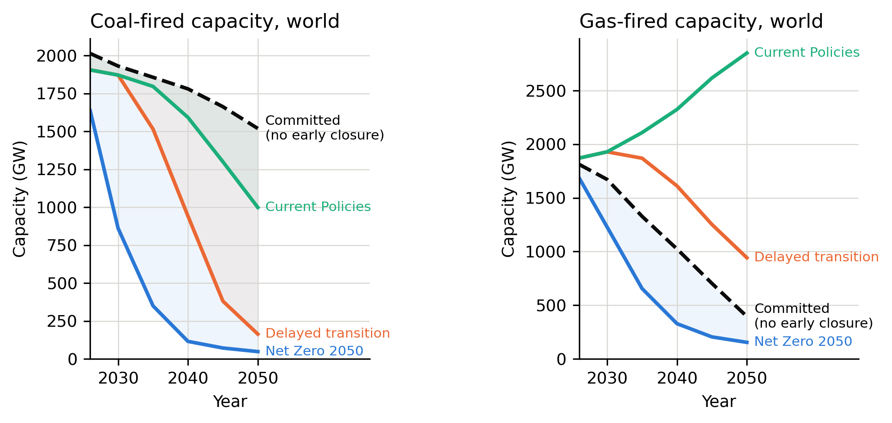

# Stranded Assets: Coal and Gas Under Climate Scenarios

How much of the world's coal and gas power capacity would have to close before the end of its technical life if the energy transition follows climate scenarios, and where is that capacity concentrated?

<p align="center">
  
</p>
<p align="center"><sub>The dashed line is the existing fleet retiring naturally; the gap down to each scenario is capacity that would have to close early. Full analysis: <a href="report/stranded_assets_report.pdf">report (PDF)</a></sub></p>

## Why I built it

This was the main project of the Environmental Economics course in my BSc AIDAMS (ESSEC × CentraleSupélec). Central banks and lenders use climate scenarios to assess transition risk, but a scenario only gives a target capacity. We wanted to measure how much of today's real fleet clashes with it.

Group project of six with Adrien Labergere, Louis Bettelli, Oscar Moulet, Lucas Magret Delord and Victor Henz. **I led the project and did most of the analysis and the writing.**

## Approach and results

- **Data:** about 29,000 power units from Global Energy Monitor's coal and gas trackers, compared with NGFS climate scenarios (Net Zero 2050, Delayed transition, Current Policies) across three integrated assessment models.
- **Method:** age each unit forward with technology-specific lifetimes, compare the surviving fleet with each scenario's capacity, and allocate the excess to the oldest units in each region first.
- **Result:** under Net Zero 2050, **1,665 GW of coal and 696 GW of gas** would still be within their working life in 2040 but exceed the pathway. Under Delayed transition, the coal gap is 839 GW; under Current Policies, 188 GW.
- **Where:** 92% of the coal exposure is in Asia, and China alone accounts for half of the combined total.

## How it works

The notebook cleans both trackers, maps countries to scenario regions, and simulates natural retirement year by year. A regression on recorded closures checks the lifetime assumptions (combined-cycle gas units retire about 15 years younger than coal), and a sensitivity analysis shifts every lifetime by ±10 years.

Three decisions shaped the analysis:
- **Capacity against capacity.** We compared gigawatts to gigawatts instead of converting generation into capacity, which would have required an unverifiable assumption about utilisation.
- **No invented data.** Units with a missing start year (about 1% of the fleet) are dropped from age-based calculations rather than imputed, since a guessed vintage directly moves the retirement date.
- **Show what holds and what doesn't.** The coal result survives every lifetime assumption tested (1,404 to 1,816 GW), while the gas result swings from 67 to 1,344 GW, so we report gas as uncertain.

**Stack:** Python, pandas, NumPy, statsmodels, Matplotlib, Jupyter, LaTeX.

## Run it

```bash
python3.11 -m venv .venv && source .venv/bin/activate
pip install -r requirements.txt
jupyter notebook stranded_assets.ipynb
```

The raw data (174 MB) is not included. Download the [Global Coal Plant Tracker](https://globalenergymonitor.org/projects/global-coal-plant-tracker/) and [Global Oil and Gas Plant Tracker](https://globalenergymonitor.org/projects/global-oil-gas-plant-tracker/) (free, CC BY 4.0) and the [NGFS Climate Scenarios v5.1](https://doi.org/10.5281/zenodo.17901363) into a `data/` folder. Details in [docs/SETUP.md](docs/SETUP.md).

## Limitations

- The results measure physical capacity, not financial losses or forecasts of actual closures.
- Recorded gas closures only start in 2020 (280 units), so gas lifetimes, and therefore the gas result, are poorly established.
- Allocating the excess "oldest first" within each region is a simplification: real closures also depend on costs, regulation and grid reliability.
